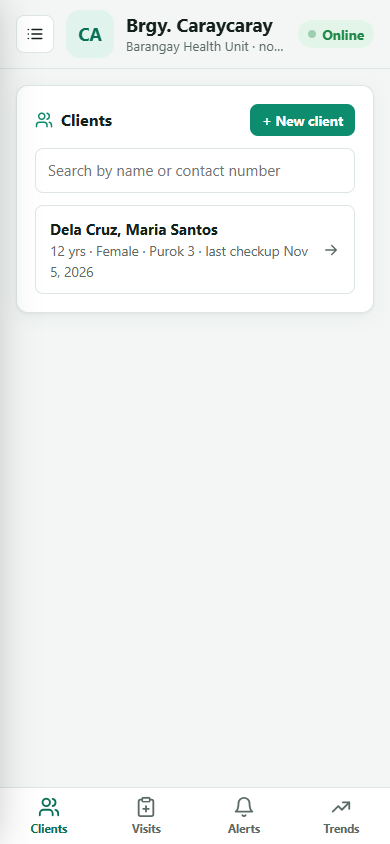
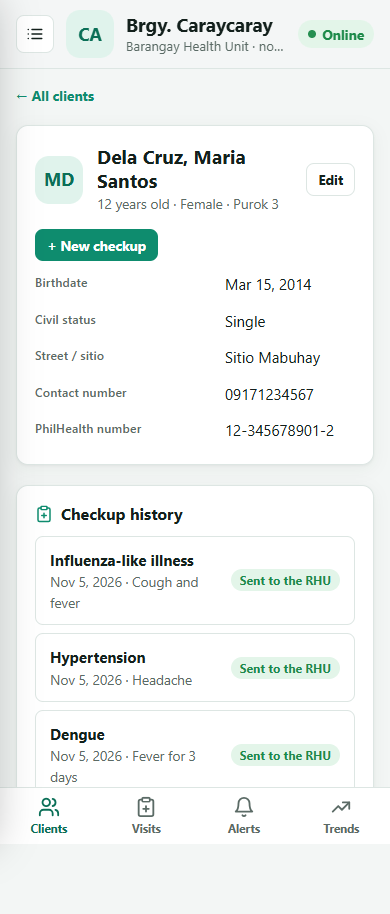
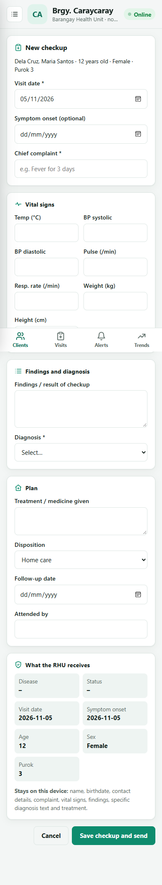
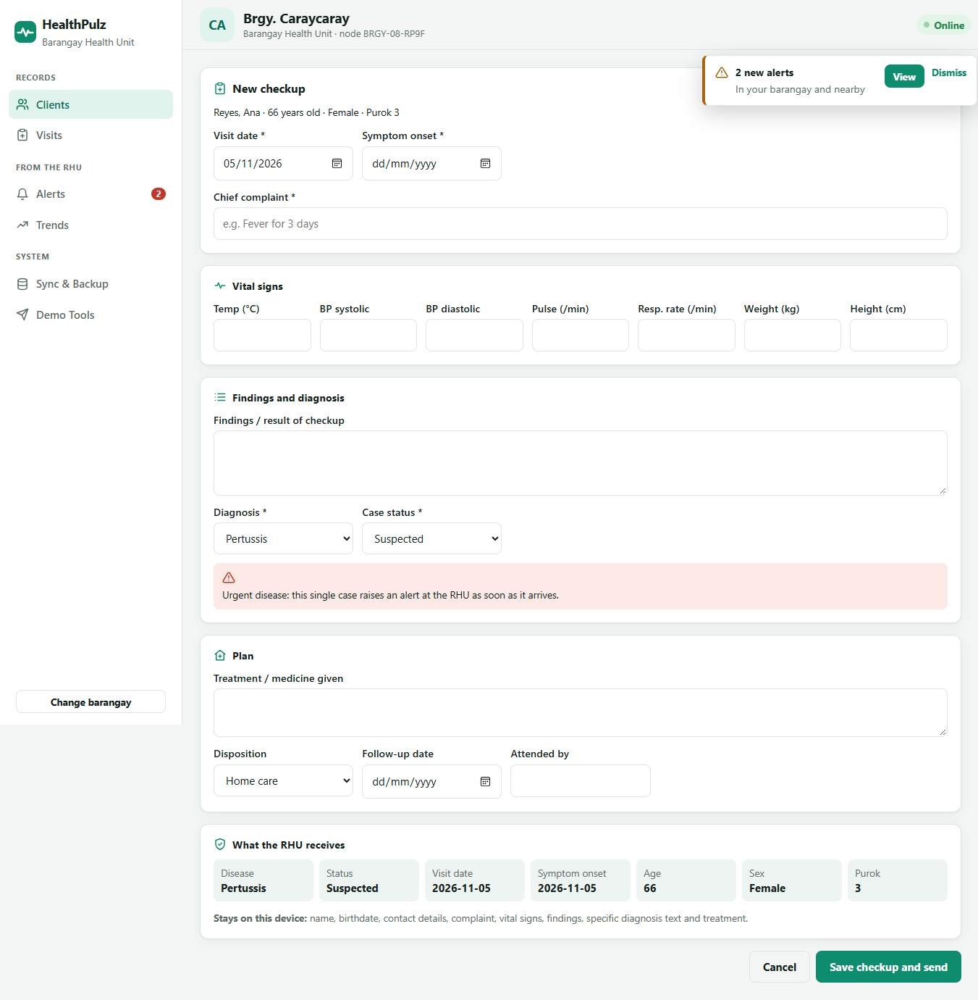
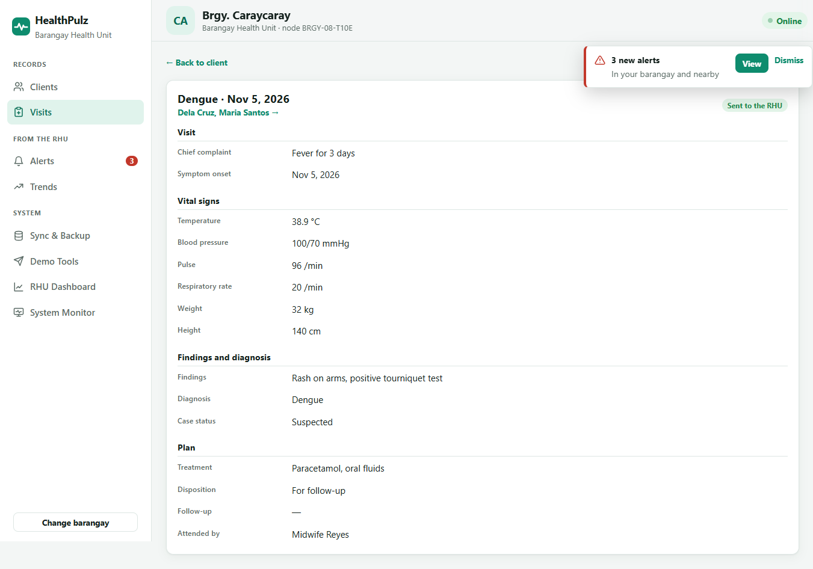
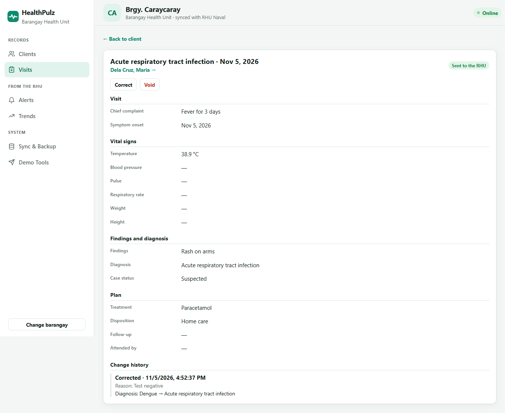
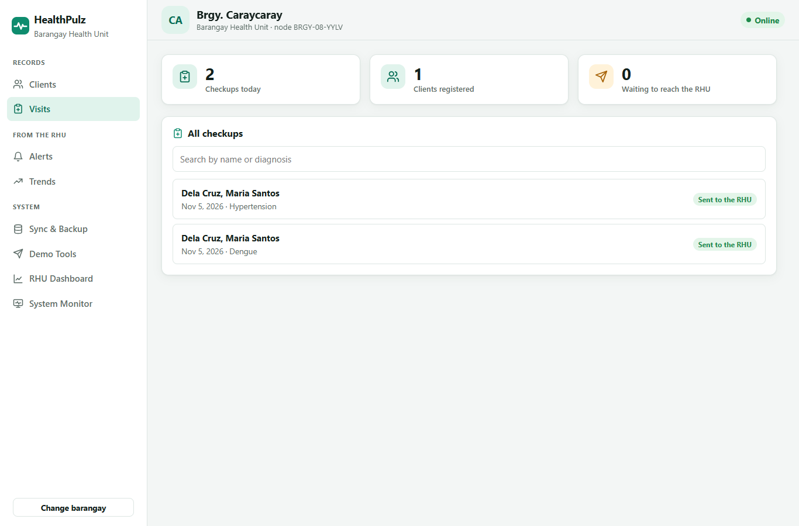

# Screen spec: BHU (Barangay Health Unit)

**For:** UI designer · **Page:** `/node/` · **Code:** [`web/node/index.html`](../../web/node/index.html), [`web/js/node/clinic.js`](../../web/js/node/clinic.js), [`web/js/node/records.js`](../../web/js/node/records.js)
**Status:** working app, ready to be refined. The *screens, data and actions* below are fixed; the *look* is yours to improve. Login is not designed yet.

| Clients (phone) | Client profile (phone) | Checkup form (phone) |
|---|---|---|
|  |  |  |

| Checkup form (desktop) | Visit record | Corrected record | Visits |
|---|---|---|---|
|  |  |  |  |

## Users and context
- **Who:** BHU workers (midwife, nurse, barangay health worker).
- **Job:** register clients, record checkups, keep their history, and see illness trends and alerts from the RHU.
- **Device:** phone or laptop, on plain HTTP on the local Wi-Fi, possibly with no internet. No web fonts or libraries from the internet.
- **Privacy:** full records stay **on this device**. The RHU receives only disease, dates, age, sex, purok and status.

## Navigation
| | Phone | Laptop |
|---|---|---|
| Main | Bottom tabs: **Clients · Visits · Alerts · Trends** | Sidebar with the same items |
| More | ☰ menu: **Sync & Backup**, **Demo Tools**, Change barangay | In the sidebar |
| Top bar | Barangay avatar and name, node ID, connection pill (Online / Connecting / Offline) | same |

Screens have their own URLs (`/node/#/client/<id>`), so reload and the Back button work. The BHU has **no links to the RHU's pages**; the logo returns to Clients.

## Screens

### 1. Choose your Barangay Health Unit
First use only: searchable barangay field and a Start button. Accents are ignored ("capinahan" finds *Capiñahan*). The choice is remembered on the device.

### 2. Clients
Search by name or contact number, **+ New client**, and a list showing name, age, sex, purok and last checkup. States: empty, no search match, and a warning if the browser can't store data (e.g. a private window).

### 3. Client form (new / edit)
Last name*, first name*, middle name, birthdate*, sex*, civil status, purok*, street/sitio, contact number, PhilHealth number. A note says these details stay on the device. Registering a client with the same name and birthdate asks for confirmation first.

### 4. Client profile
Name, age, sex and purok, the other details, **Edit**, **+ New checkup**, and the checkup history. Each history row has a delivery badge.

### 5. Checkup form
| Section | Fields |
|---|---|
| Visit | Visit date* (today by default, can't be in the future), symptom onset (*required for diseases that can raise alerts*), chief complaint* |
| Vital signs | Temperature, BP systolic/diastolic, pulse, respiratory rate, weight, height (optional; realistic ranges are enforced) |
| Findings and diagnosis | Findings, diagnosis*: grouped as **Common illnesses** (the RHU's 10), **Urgent** (6), **Also monitored** (3), or **Other (specify)**. A listed disease adds **Case status** (Suspected/Confirmed); an urgent one also shows a warning note; Other adds **Specify diagnosis*** |
| Plan | Treatment, disposition (Home care / For follow-up / Referred to RHU / Referred to hospital), follow-up date, attended by |
| What the RHU receives | Live preview of the exact report, and what stays on the device |

Main action: **Save checkup and send**. In correction mode (below) the title and button change, and a required **Reason for correction** appears.

### 6. Visits
Key numbers: checkups today, clients registered, waiting to reach the RHU. Then all checkups, newest first, searchable by name or diagnosis.

### 7. Visit record
The full record in sections, with a link to the client, **Correct** and **Void** buttons, a **Change history** (when, reason, old → new value), and a delivery badge:
- **Waiting to reach the RHU** (warning): saved, not yet confirmed; it sends by itself when the connection returns
- **Sent to the RHU** (OK): confirmed stored by the RHU
- **Rejected by the RHU** (danger): shown with the reason
- **Void waiting to reach the RHU** (warning), then **Voided** (OK)

**Correct** opens the checkup form filled in; it needs a reason and at least one change. **Void** asks for a reason in a confirmation dialog, can't be undone, and marks the record as voided (crossed out in lists, not counted in "Checkups today"). A corrected record shows a **Corrected** chip in lists. Reasons and history stay on the device; the RHU only receives the corrected report. Checkup under the wrong client: void it and record it again under the right client.

If a client's **birthdate or sex** is corrected, their past reports are re-sent automatically and each checkup's history notes it. A change of **purok** is treated as moving: past reports keep the purok at the time of the visit.

### 8. Alerts
Cards colored by level (ALERT, EPIDEMIC, URGENT), with "In your barangay" or "Nearby: Brgy. X". A new alert on another screen shows one pop-up notice (grouped if several arrive together), raises the count on the tab, and vibrates phones. After a reload, alerts already seen are listed quietly.

### 9. Trends
Map of Naval with this barangay outlined, a table per disease (your barangay this week, Naval this week and last week, barangays on alert) plus an **Other consultations** row, and a 12-week chart with thresholds. It updates about 11 s after new data. A note says only aggregated counts are shared.

### 10. Sync & Backup
- **Delivery numbers:** batches waiting, cases stored, duplicates, rejected.
- **Backup:** **Download backup** and **Restore from file**, with a warning that records live only in this browser and that the file contains private data. A backup from another barangay is refused.
- **Activity log.**

### 11. Demo Tools
Clearly marked as demonstration only; it creates no client records.
- **Realistic week**, with optional **Simulate an outbreak**.
- **Stress test** (1–5,000 cases, sent as a drill, so it never raises alerts).

## Color meanings (same as the other screens)
OK = online, sent to the RHU · Warning = ALERT, waiting, connecting · Danger = EPIDEMIC, rejected, offline, errors · Urgent (purple) = URGENT · Accent = primary buttons, selected items.
