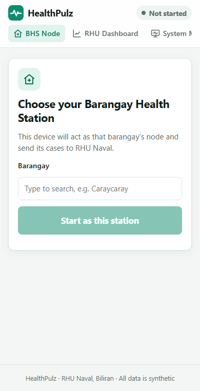
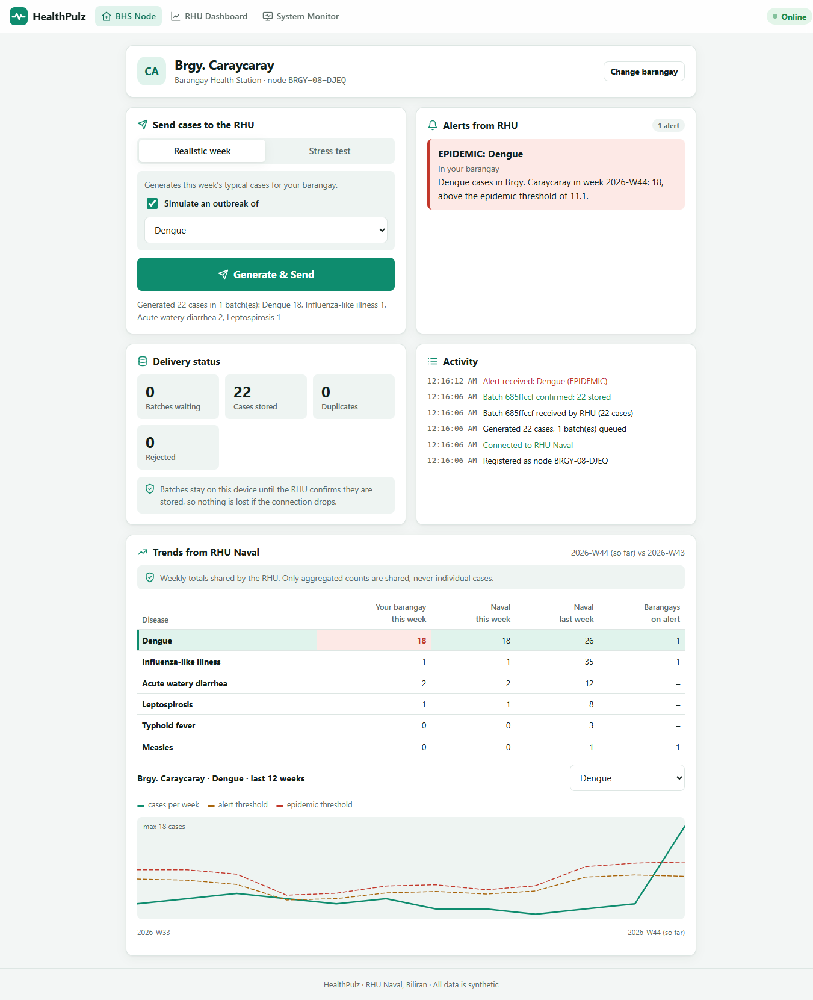
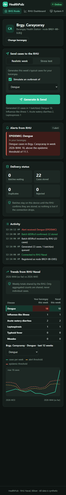

# Screen spec: BHS Node

**For:** UI designer · **Page:** `/node/` · **Code:** [`web/node/index.html`](../../web/node/index.html), [`web/js/node/main.js`](../../web/js/node/main.js)
**Status:** working prototype, ready to be redesigned. The *components, data and actions* below are fixed; the *look* is yours to design.

| Choose a barangay | Station with alerts | Phone |
|---|---|---|
|  |  |  |

## Purpose and context

- **Who:** a Barangay Health Station worker (midwife, BHW, nurse). In the demo, **each classmate is one station** and opens this page on their **own phone or laptop**.
- **Job:** send the barangay's cases to the RHU, and receive outbreak alerts.
- **Device:** **mostly phones**, so design mobile-first.
- **Network:** plain HTTP on the local Wi-Fi, possibly with no internet. Avoid web fonts and libraries loaded from the internet.

## Two steps

### Step 1 · Choose your Barangay Health Station
| | |
|---|---|
| Shows | Title, one line of explanation, a **searchable barangay field**, a **Start** button |
| Search | Type part of a name to filter the 26 Naval barangays. Accents are ignored ("capinahan" finds *Capiñahan*). Arrow keys and Enter work. "No barangay found" when nothing matches. |
| Start button | Disabled until a barangay is chosen |
| Error state | "Cannot reach the RHU server. Check the Wi-Fi and reload." |
| Remembered | After Start, the choice is saved on the device. Reloading goes straight to Step 2. |

### Step 2 · The station

#### Station header
Barangay name (e.g. **Brgy. Caraycaray**), node ID (`BRGY-08-24Y4`, small, for troubleshooting), and a **Change barangay** button, which asks for confirmation first.

#### Connection pill (page header)
**Not started** (neutral) → **Connecting…** (warning) → **Online** (OK) / **Offline** (danger). It reconnects by itself.

#### Generate cases
| Control | Behavior |
|---|---|
| Mode toggle | **Realistic week** / **Stress test** |
| Realistic week | Generates this week's typical cases for the barangay. Optional **Simulate an outbreak** checkbox + disease dropdown: generates enough cases of that disease to go **above the RHU's epidemic threshold** for this barangay and week, so it **always triggers a real alert**, in any season. |
| Stress test | **Number of cases** (1–5,000, default 500), plus a note: stress-test cases are a **drill**, stored and counted but they never raise alerts |
| **Generate & Send** | The main action of the page |
| Result line | e.g. "Generated 22 cases in 1 batch(es): Dengue 16, Influenza-like illness 4, …", or "No cases this week" |

#### Status (4 numbers)
| Number | Meaning |
|---|---|
| Batches waiting | Saved on this device, not yet confirmed by the RHU. Usually 0; rises if the Wi-Fi drops. |
| Cases stored | Confirmed by the RHU |
| Duplicates | Cases the RHU already had (safe resends) |
| Rejected | Cases the RHU refused as invalid (rare) |

Plus one reassuring line: *"Batches stay on this device until the RHU confirms they are stored, so nothing is lost if the connection drops."* This is the **offline-first** feature, worth keeping visible.

#### Alerts from RHU
| Part | Example |
|---|---|
| Card color | warning (**ALERT**) or danger (**EPIDEMIC**) |
| Title | `EPIDEMIC: Dengue` |
| Scope line | **In your barangay**, or **Nearby: Brgy. Catmon** for a neighboring barangay's alert |
| Message | "Dengue cases in Brgy. Caraycaray in week 2026-W44: 13, above the epidemic threshold of 11.1." |

- **States:** empty ("No alerts yet."); new alert; an **escalated** alert updates its existing card instead of adding another.
- **Arrival:** alerts arrive **by themselves** within about 10 s of the outbreak data. This is the highlight moment of the demo, so consider an attention cue (animation, sound, or vibration on phones).
- **Offline:** a station that was offline receives missed alerts when it reconnects.

#### Activity log
Time-stamped lines, newest first, kept to the last 100:
- connected / registered
- batch received by the RHU → batch confirmed (stored, duplicates, rejected)
- RHU busy, retrying
- cannot reach the RHU / reachable again
- alerts received

Errors use the danger color, confirmations the OK color. On a phone this could be collapsed by default.

#### Trends from RHU Naval
This is the part of the system where **barangays see RHU data**.

| Part | Content |
|---|---|
| Header | "Trends from RHU Naval" + the weeks compared, e.g. `2026-W44 (so far) vs 2026-W43` |
| Privacy line | "Weekly totals shared by the RHU. Only aggregated counts are shared, never individual cases." Keep it visible; it answers the obvious defense question. |
| Table (6 rows) | Disease · **Your barangay this week** (cell colored if on ALERT/EPIDEMIC) · **Naval this week** · **Naval last week** · **Barangays on alert** (`–` when none) |
| Chart | Your barangay, **one disease, last 12 weeks**: cases (solid) + alert threshold + epidemic threshold (dashed). The disease is chosen with a dropdown **or by clicking a table row** (the selected row is outlined). |
| Updates | Every 30 s, and about 11 s after this station's data is stored or an alert arrives (the RHU analyzes new data every 10 s) |
| Error state | "Trends will update when the RHU can be reached again." |
| Phone | The table scrolls sideways inside the card; consider a compact list instead |

Data: `GET /api/stats/summary`, `GET /api/stats/barangays?week=…`, `GET /api/stats/trend?disease=…&barangay_id=…&weeks=12`.

## Color meanings (same as the other screens)
OK = online / confirmed · Warning = ALERT, connecting · Danger = EPIDEMIC, offline, errors · Accent = primary button, selected mode.
