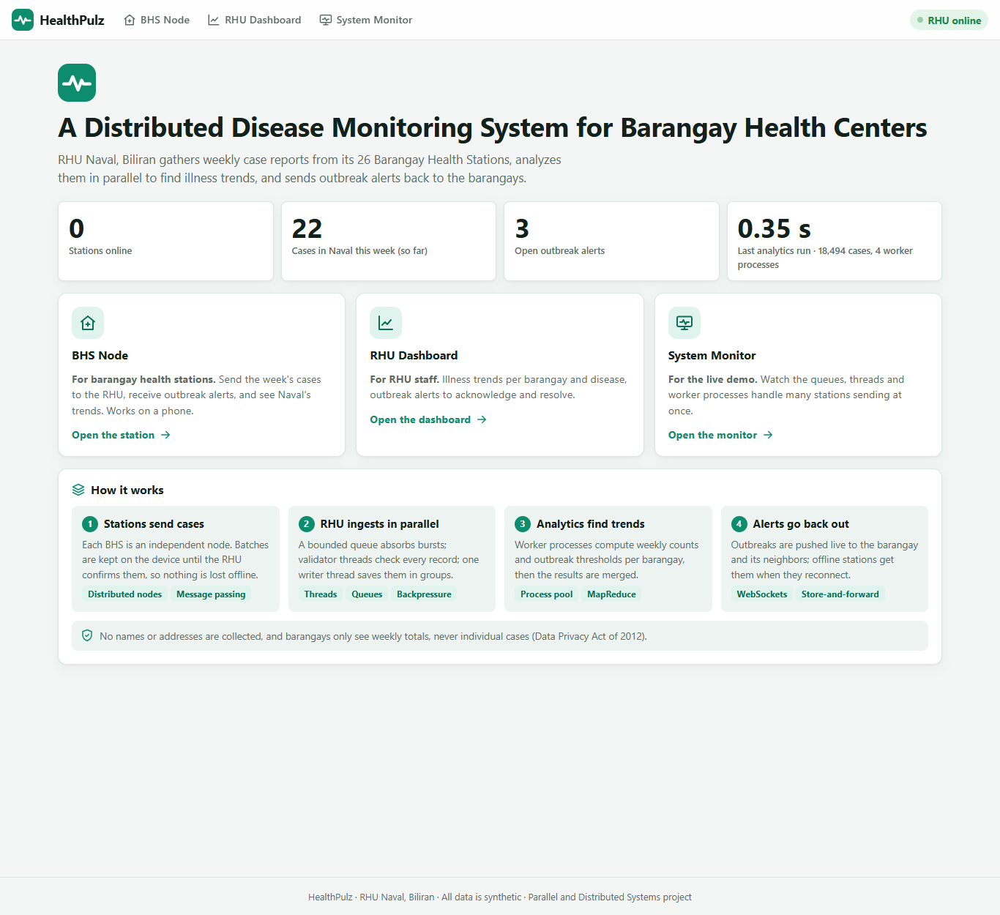
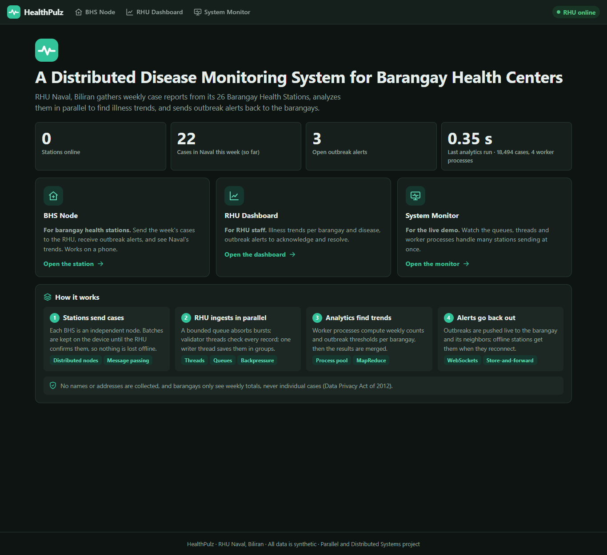

# HealthPulz design system (starting point)

**For:** UI designer · **Code:** [`web/css/base.css`](../../web/css/base.css), [`web/img/icons.svg`](../../web/img/icons.svg)

The current interface is a **working first version**. Use it as the base: refine the colors, type, spacing and components here, and every page changes with them. All pages share this one stylesheet.

| Home, light | Home, dark |
|---|---|
|  |  |

Screen specs: [Home](#home-page) · [BHS Node](bhs-node.md) · [RHU Dashboard](rhu-dashboard.md) · [System Monitor](system-monitor.md)

## Constraints (please keep)
- **No internet needed:** the demo runs on a local router. No Google Fonts, icon CDNs or chart libraries. Fonts come from the device (Segoe UI on Windows, Roboto on Android, San Francisco on iPhone); icons are a local SVG file; charts are plain SVG.
- **Light and dark mode:** both follow the device setting. Every color is defined twice (see tokens).
- **Phone first for the BHS Node page:** classmates use their phones. The dashboard and monitor are mainly laptop/projector.
- **Color = meaning:** the same four meanings on every screen (below). Don't reuse warning or danger colors for decoration.

## Color tokens
| Token | Light | Dark | Meaning / use |
|---|---|---|---|
| `--accent` | `#0e8c6e` | `#33c39b` | Brand, primary buttons, selected items, main chart line |
| `--ok` | `#1d8a4a` | `#4cc47f` | Online, confirmed, "nothing lost" |
| `--warn` | `#a8640a` | `#e6ad4e` | **ALERT** level, connecting, queue > 50% |
| `--danger` | `#c2372a` | `#f07062` | **EPIDEMIC** level, offline, errors, queue > 80% |
| `--urgent` | `#8e1f7a` | `#e684d4` | **URGENT** level: a single case of the RHU's urgent diseases |
| `--bg` / `--surface` / `--surface-2` | `#f3f6f5` / `#fff` / `#eef4f2` | `#0e1412` / `#161f1c` / `#1d2824` | Page / cards / insets |
| `--text` / `--text-muted` | `#13201c` / `#5b6b66` | `#e5eeeb` / `#93a49e` | Body text / secondary text |

Each color also has a `-soft` background version (e.g. `--warn-soft`) for badges, cells and alert cards.

## Type and spacing
- **Font:** system UI font, 15 px base. Headings 650 weight: h1 1.35rem, h2 1rem, h3 0.9rem.
- **Numbers:** tabular figures, so counts don't jump around while they update live.
- **Spacing:** 16 px between cards, 18 px inside cards, 12 px corner radius on cards and 8 px on controls.

## Components (class names in `base.css`)
| Component | Class | Notes |
|---|---|---|
| **App shell** | `.app` > `.sidebar` (`.nav-label`, `.nav-link`, `.count`) + `.main` > `.topbar` + `.content` > `.screen` | Used by the Dashboard, Node and Monitor. Below 960 px the sidebar slides in from the ☰ button (`.menu-btn`, `.scrim`) |
| Bottom tab bar | `.app.has-tabbar .tabbar` | BHS Node on phones: 4 tabs with an unread count |
| Screens | `section[data-screen]`, links `href="#/name"` with `data-nav` | One screen at a time; the URL remembers it (`web/js/common/shell.js`) |
| KPI card | `.kpi` (`.kpi-icon`, `.kpi-value`, `.kpi-label`, `.kpi-sub`), tone `data-tone="warn/danger/ok"` | Overview key numbers |
| Pop-up notice | `.toast[data-level]` via `toast()` in `shell.js` | New alert while on another screen; View + Dismiss; disappears after 8 s |
| **Map of Naval** | `.map` (`.town`, `.brgy[data-level]`, `.town-outline`, `.marker`, `.brgy-label`), `.map-legend` | `web/js/common/naval-map.js`; see below |
| Filter chips | `.filter-chip[aria-pressed]` | Disease filters on Map and Trends |
| Card | `.card`, `.card-header`, `.section-title` | Section titles have a leading icon in the accent color |
| Buttons | `.btn` + `.btn-primary` / `.btn-ghost`, sizes `.btn-small` / `.btn-large`, `.btn-block` | One primary button per area |
| Toggle | `.segmented` | Mode switches: Realistic/Stress, Active/Resolved/All, This/Last week |
| Status pill | `.pill[data-state=online/connecting/offline]` | Pulsing dot when online |
| Badge | `.badge[data-level=ALERT/EPIDEMIC/RESOLVED]` | Alert levels and counts |
| Number tile | `.stats` > `.stat` (`.stat-value`, `.stat-label`, `.stat-sub`) | `.stats.compact` fits 4 in a half-width card |
| Alert card | `.alert-card[data-level]` (node), `.alert-row` (dashboard) | New alerts pulse 3 times (`.is-new`) and vibrate on phones |
| Info note | `.note` | Privacy and "nothing is lost" reassurances, with a shield icon |
| Heatmap table | `table.heat`, cells `td[data-level]` | Scrolls sideways inside its card on phones |
| Charts | `.chart`, `.legend`, `.axis`, `.series-*` | Dashed lines for thresholds |
| Chips | `.chip` | PDC concept tags on the home page |

**Motion:** the online dot and new-alert pulse turn off when the device asks for reduced motion.

## Icons
`web/img/icons.svg` is a sprite of simple line icons (24×24, 2 px stroke, color follows the text). Use:
```html
<svg class="icon" aria-hidden="true"><use href="/img/icons.svg#alert"/></svg>
```
Available: `logo`, `station`, `dashboard`, `monitor`, `alert`, `bell`, `send`, `nodes`, `database`, `cpu`, `layers`, `shield`, `trend`, `list`, `table`, `pin`, `arrow`, `pulse`.
To add or replace an icon, add a `<symbol id="…" viewBox="0 0 24 24">` with the same stroke settings.

**Logo:** a rounded square in the accent color with a white pulse line (`#logo`). It's a placeholder; replace it freely, but keep it a single SVG so it stays offline.

## Login page
The page at `/`: logo, health unit and password fields, and the privacy note. See [login.md](login.md).

## Map of Naval
- **Data:** drawn as SVG from `web/data/map.json`, built by [`tools/build_map.py`](../../tools/build_map.py) from official PSA PSGC boundaries (via faeldon/philippines-json-maps, MIT). No tiles or map library, so it works offline. Keep the attribution line.
- **Layers, bottom to top:**
  1. sea (`--sea`)
  2. the other towns of Biliran, greyed out (`--land-muted`)
  3. Naval's barangays (`--land`, colored by level)
  4. Naval's boundary, thick, accent color
  5. case markers (size = cases; EPIDEMIC markers pulse)
  6. names
- **Map colors:** `--sea`, `--land`, `--land-muted`, `--map-line`, each with a light and dark value.
- **Interaction:**
  - hover shows a tooltip
  - click selects a barangay (Dashboard) or shows its numbers (Node, where tapping replaces hover)
  - the station's own barangay gets a thick outline (`.own`)

## Ideas not done yet
- A **QR code** for the join address on the System Monitor. It must be generated without an internet library.
- **Sound** when an alert arrives on the node page.
- An **inset** for Higatangan island on the map, so the mainland barangays can be drawn larger.
