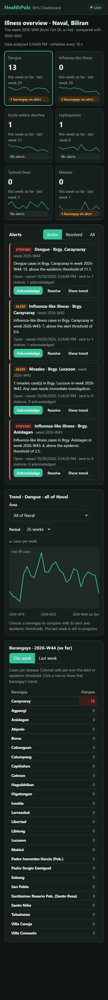
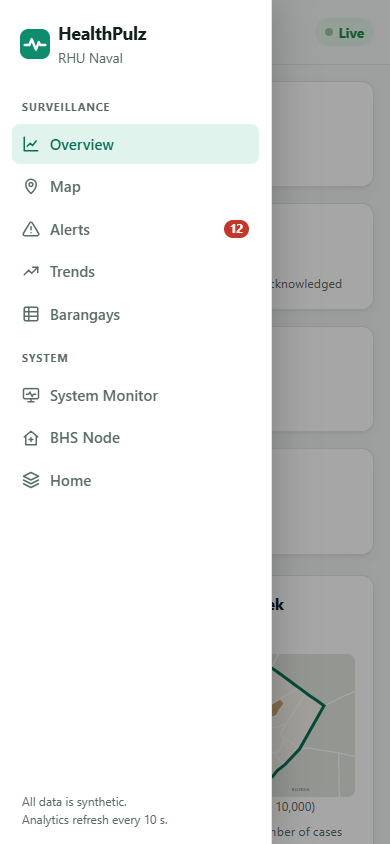

# Screen spec: RHU Dashboard

**For:** UI designer · **Page:** `/dashboard/` · **Code:** [`web/dashboard/index.html`](../../web/dashboard/index.html), [`web/js/dashboard/main.js`](../../web/js/dashboard/main.js), map: [`web/js/common/naval-map.js`](../../web/js/common/naval-map.js)
**Status:** working app, ready to be refined. The *screens, components, data and actions* below are fixed; the *look* is yours to improve.

| Overview | Map |
|---|---|
|  |  |

| Alerts | Phone | Phone menu |
|---|---|---|
|  |  |  |

## Users and context
- **Who:** RHU Naval staff (Municipal Health Officer, nurses, surveillance officer).
- **Job:** see where and which illnesses are rising, and act on outbreak alerts.
- **Device:** laptop or desktop at the RHU; must still work on a phone.
- **Live data:** refreshes by itself **every 10 s** (the analytics interval). The number of stations online updates every second.
- **"So far":** the current week isn't over, so its numbers are usually lower than last week's. This must always be clear; the top bar says "(so far)".

## Layout (app shell)
| Part | Content |
|---|---|
| **Sidebar** | Logo + "RHU Naval"; *Surveillance*: **Overview, Map, Alerts** (red count of open alerts), **Trends, Barangays**; *System*: System Monitor (no links to the BHU's page); footer "All data is synthetic". On phones it slides in from a ☰ button over a dimmed page. |
| **Top bar** | Screen title + one-line description · **week chip** ("Week 2026-W44 · from Oct 26 (so far)") · live pill (**Live** / **Reconnecting…**) · user chip "RHU Staff" |
| **Screens** | One at a time. The URL remembers it (`/dashboard/#/map`), so reload and the Back button work. |

## Screen 1 · Overview (default)
1. **4 KPI cards:**
   - **Cases this week (so far)**, with last week under it
   - **Open outbreak alerts** (how many at epidemic level, how many not yet acknowledged)
   - **Barangays with cases** (`5 / 26`, how many over a threshold)
   - **BHS stations online** (registered stations, barangays covered)
2. **Map card**: small map of Naval, all diseases, with **This week / Last week** (shared with the Map screen) and a line saying which week is shown and its total. Past data ends last week, so "This week" holds only real entries and can look nearly empty. Clicking a barangay opens it on the Map screen. Link: "Open map →".
3. **Latest alerts**: the 4 newest active alerts, compact (level, disease, barangay, week, cases vs threshold), with **Acknowledge / Resolve / Show trend**. Link: "View all →".
4. **Latest reports**: the 20 newest reports from the BHUs, newest first, live over the WebSocket feed. Each row: time received, disease, barangay, age, sex, purok, status (Suspected, Confirmed, **Corrected** or **Voided**), checkup date, when the illness started and which week it counts in. New rows flash. No client names. Stress-test data and imported history aren't listed. Empty state: "No reports yet…". A case counts in the week of its checkup, so a checkup dated today raises this week's numbers once the analytics finish, and the screen refreshes as soon as they do.
5. **Common illnesses** (the RHU's 10 + dengue, leptospirosis and typhoid, tagged "Also monitored"): ranked by cases this week, with last week, a 12-week sparkline and "N barangays on alert". Clicking one opens Trends.
6. **Urgent diseases** (6): count this week and last week. A row with a case turns the urgent color. A single case raises an alert.

## Screen 2 · Map
The **municipality of Naval is the focus**:
- **Naval highlighted:** its boundary is drawn as a thick accent-colored outline, its 26 barangays in a light land color, and the **other towns of Biliran greyed out** around it. The sea is blue, with a "Municipality of Naval" badge.
- **Barangays are flagged by color:**
  - no cases: plain land
  - cases: green, darker = more cases per 10,000 people
  - **ALERT:** warning color
  - **EPIDEMIC:** danger color
  - **URGENT:** purple, its own color
- **Markers:** a circle on each barangay with cases; size = number of cases; EPIDEMIC markers pulse.
- **Labels:** barangay names (smaller in the tight poblacion area; hidden on phones, where you tap instead).
- **Filters:** a disease dropdown grouped as Common / Urgent / Also monitored, and **This week / Last week**.
- **Hover:** tooltip with name, cases, rate per 10,000, level.
- **Click a barangay:** fills the **Barangay details** panel:
  - avatar, name, week, level badge
  - cases, per 10,000, population
  - per-disease rows with level badges
  - **neighbors** (they also receive its alerts)
  - **Open trend** button
- **Offline:** the map is drawn from official PSA boundary data stored in the project (no map tiles), so it works without internet. The attribution line under the map must stay.

## Screen 3 · Alerts
Filter: **Active** (open + acknowledged) · **Resolved** · **All**. Newest first. Each alert:
- **Level badge and heading:** URGENT, EPIDEMIC or ALERT; disease · barangay · week.
- **Message:** e.g. "Dengue cases in Brgy. Cabungaan in week 2026-W44: 9, above the epidemic threshold of 3.2."
- **Status line:** Open / Acknowledged by RHU / Resolved · when it was raised · **sent to N stations, M acknowledged** (the distributed delivery, made visible).
- **Corrected note:** if BHU corrections lowered the count after the alert was raised, a note shows the new count and asks staff to review it. The alert isn't closed automatically.
- **Actions:**
  - **Acknowledge**: only when Open
  - **Resolve**
  - **Reopen**: only when Resolved
  - **Show trend**

Expect around 5–15 active alerts. About 7 per week are false alarms from the synthetic data (see [analytics.md](../analytics.md)). The 6 urgent diseases alert on **one** case.

## Screen 4 · Trends
- **Disease dropdown:** grouped like the map's, plus Other consultations.
- **Area:** All of Naval, or one barangay.
- **Period:** 12, 26 or 52 weeks.
- **Line chart:**
  - cases per week (solid)
  - with one barangay selected, also the **alert threshold** and **epidemic threshold** (dashed)
  - thresholds are hidden for "All of Naval" on purpose (adding them across barangays isn't statistically valid), and for diseases without thresholds; the note under the chart says why
- **Axis:** first, middle and last week, the last marked "(so far)".
- **Note under the chart:** explains the thresholds.

## Screen 5 · Barangays
Heatmap table: all 26 barangays, with a **Common / Urgent / Monitored** switch for the disease columns, plus All tracked, Other and **Per 10,000**, sorted by rate.
- **Toggle:** This week / Last week.
- **Cell colors:** ALERT, EPIDEMIC and URGENT cells are colored; zeros are muted.
- **Hover a cell:** shows its thresholds.
- **Click a row:** opens the barangay on the Map.
- **Phones:** the table scrolls sideways inside its card.

## Screen 6 · BHU Accounts
Only the RHU gives a BHU its password, so this screen is the way a BHU gets access.

1. **Summary line:** "12 of 26 BHUs have a password. A BHU without one cannot log in."
2. **Generate for the other N** button: only while some BHUs have no password.
3. **One row per BHU, A–Z:** name, status (**Has password** / **No password yet**), date given, and a **Give password** or **Change password** button.
4. **Password dialog:** one field, blank to generate. Typed passwords need 8+ characters. When changing, it warns that the old password stops working and the BHU's devices are logged out.
5. **"Give these to the BHU" dialog:** the passwords just given, with **Print** and **Done**. It's the only time they can be seen, so it stays open until **Done**. The printout shows only the list.

Passwords are never stored in readable form, so there is deliberately no "show password" action: a lost password means giving a new one.

## Data sources
| Component | Endpoint |
|---|---|
| Top bar, KPIs, disease cards | `GET /api/stats/summary`, `GET /api/stats/trend` (sparklines), `WS /ws/monitor` (stations online) |
| Latest reports | `latest_reports` in `WS /ws/monitor` |
| Map, Barangays | `GET /api/stats/barangays?week=…` (this week and last week) |
| Alerts | `GET /api/alerts`, `POST /api/alerts/{id}/status` |
| Trends | `GET /api/stats/trend?disease=…&barangay_id=…&weeks=…` |
| BHU Accounts | `GET /api/accounts`, `POST /api/accounts/{barangay_id}/password`, `POST /api/accounts/assign-missing` |
| Map shapes | `/data/naval-map.json` (built by [`tools/build_map.py`](../../tools/build_map.py)) |

## Known limits
- **One shared RHU login:** the system can't tell which staff member acknowledged or resolved an alert.
- **Synthetic populations:** they affect the "per 10,000" rates.
