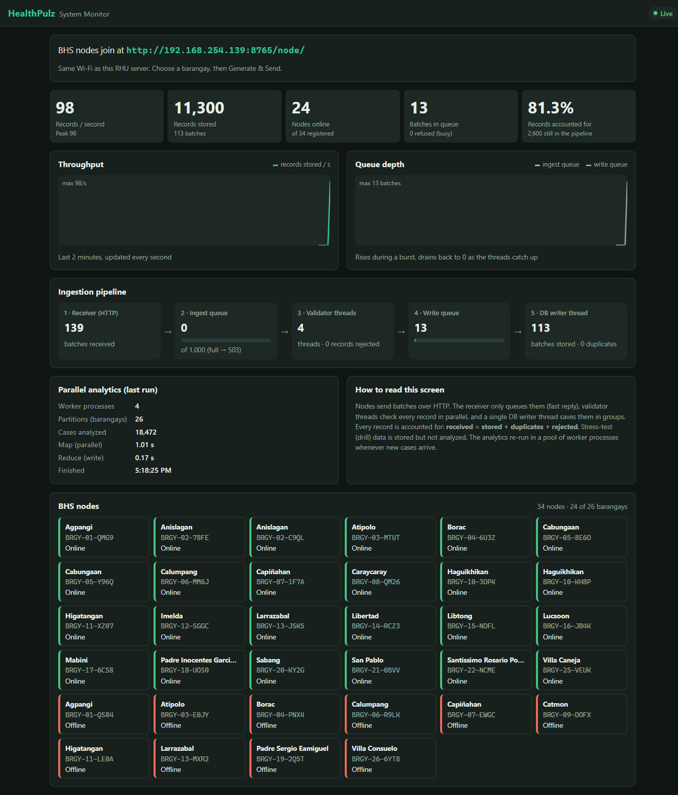
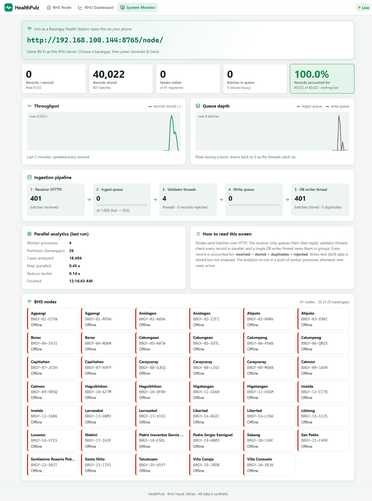

# Screen spec: System Monitor

**For:** UI designer · **Page:** `/monitor/` · **Code:** [`web/monitor/index.html`](../../web/monitor/index.html), [`web/js/monitor/main.js`](../../web/js/monitor/main.js)
**Status:** working prototype, ready to be redesigned. The *components and data* below are fixed; the *look* is yours to design.

| During a 40-node burst | After the burst |
|---|---|
|  |  |

## Purpose and context

- **What it's for:** shows that the system handles many nodes sending data at the same time, with nothing lost. It's the main screen of the live demo.
- **Where it's seen:** **on the projector** during the defense, so the key numbers must be readable from the back of the room. It's also opened on laptops, and should still work on a phone.
- **Who uses it:** the panel and classmates during the demo; RHU staff checking that the system is healthy.
- **Interaction:** none. It's read-only and updates itself **every second** over a live connection. There are no buttons, filters or inputs.
- **Demo story it must tell, in order:**
  1. Classmates join, and the node tiles turn green one by one.
  2. Everyone presses Send at once: records/second spikes, and the queue rises.
  3. The queue drains back to 0.
  4. "Records accounted for" reaches **100% · nothing lost**.

## Components (top to bottom)

### 1. Join banner
| | |
|---|---|
| Shows | The address classmates type on their phone/laptop, e.g. `http://192.168.254.139:8000/node/`, plus one line of instructions |
| Data | `GET /api/server/addresses` (once, on load). There can be **more than one address** if the laptop has several network adapters. |
| States | Loading (`…`); one address; several addresses |
| Notes | Must be **very large and easy to copy by eye** from the projector. A QR code of the address would be a good addition. |

### 2. Key numbers (5 tiles)
| Tile | Big number | Small line under it | Field(s) in the feed |
|---|---|---|---|
| Records / second | current throughput | `Peak 12,202` (highest since the page opened) | `pipeline.records_per_second` |
| Records stored | total stored | `400 batches` | `records_accepted`, `batches_stored` |
| BHUs online | online count | `35 devices connected · 26 active in 12 hours` | `nodes[].status`, `nodes[].connections` |
| Batches in queue | ingest + write queue | `0 refused (busy)`, count of HTTP 503 replies | `ingest_queue`, `write_queue`, `batches_busy` |
| Records accounted for | percentage, e.g. `100.0%` | `2,600 still in the pipeline` **or** `40,000 of 40,000 · nothing lost` | `records_received`, `records_accepted`, `records_duplicate`, `records_rejected` |

- **States:** the last tile shows `–` before any data. While records are still moving through the pipeline it's below 100%, and that's normal, not an error.
- **Highlight:** "Records accounted for" at **100% · nothing lost** is the proof of the whole demo, so it deserves the most emphasis.

### 3. Throughput chart
| | |
|---|---|
| Shows | Line chart of records stored per second over the **last 2 minutes** (120 points, newest on the right) |
| Labels | The scale's maximum (`max 12,202/s`) |
| States | Flat at 0 when idle; a sharp spike during a burst (bursts last only a few seconds) |
| Notes | No chart library is used: charts are plain SVG so they work **without internet**. Keep that in mind; avoid designs that need a charting library. |

### 4. Queue depth chart
| | |
|---|---|
| Shows | Two lines over the last 2 minutes: **ingest queue** and **write queue** (batches waiting) |
| Message | It rises during a burst and drains back to 0. That's the visual proof of backpressure and parallel processing. |
| Notes | The two lines need clearly different colors, plus a legend. |

### 5. Ingestion pipeline (5 stages)
A left-to-right flow that mirrors the architecture diagram. The docs team uses it to explain the threads.

| Stage | Main number | Extra |
|---|---|---|
| 1 · Receiver (HTTP) | batches received | — |
| 2 · Ingest queue | batches waiting | fill bar vs. capacity (1,000) and the text "full → 503" |
| 3 · Validator threads | number of threads (4) | records rejected |
| 4 · Write queue | batches waiting | fill bar |
| 5 · DB writer thread | batches stored | duplicates |

- **Fill bars:** normal color under 50% full, **warning** over 50%, **danger** over 80% (it's at 503 when full).
- **Narrow screens:** the stages wrap onto several rows and the arrows are hidden. A vertical flow could look better there.

### 6. Parallel analytics (last run)
| Label | Example | Field |
|---|---|---|
| Worker processes | 4 | `analytics.workers` |
| Partitions (barangays) | 26 | `analytics.partitions` |
| Cases analyzed | 18,472 | `analytics.cases` |
| Map (parallel) | 0.39 s | `analytics.map_seconds` |
| Reduce (write) | 0.21 s | `analytics.reduce_seconds` |
| Finished | 5:18:36 PM | `analytics.finished_at` |

- **State:** "Waiting for the first run…" until the server has run the analytics once, a few seconds after it starts.
- **Note:** the parallel-computing part of the system. A small visual of the workers (4 boxes) could show this better than a table.

### 7. "How to read this screen"
A short paragraph explaining the flow for the panel. Optional in the final design; it could become a tooltip or speaker notes instead.

### 8. BHS nodes grid
| | |
|---|---|
| Shows | One tile per barangay's station, if connected or active in the last 12 hours, plus any other connected ID (older ones stay in the database but are hidden): **barangay name**, station ID (e.g. `BRGY-08-MAIN`), **Online · N devices** or **Offline**, and "N waiting" if the node has unsent batches |
| Order | Online first, then alphabetical by barangay |
| Count | Header line: `40 nodes · 26 of 26 barangays`. Expect **up to 26 tiles**, one per barangay; several devices can share one. Load-test nodes from the simulator also appear, only while connected. |
| States | Empty ("No nodes yet…"); online (green); offline (red); long barangay names (e.g. *Santissimo Rosario Pob. (Santo Rosa)*) must truncate or wrap cleanly |
| Data | `nodes[]`: `node_id`, `barangay_id`, `status`, `pending_batches` |

### Header
Brand, page name and a connection pill: **Live** (green), **Connecting…** (amber), **Disconnected, retrying…** (red). Shown when the monitor itself loses the server.

## Color meanings (keep these consistent across all screens)
| Meaning | Used for |
|---|---|
| OK / online | node online, Live pill |
| Warning | queue > 50%, ALERT level, Connecting |
| Danger | queue > 80%, node offline, EPIDEMIC level, Disconnected |
| Accent (brand) | main numbers, throughput line, links |

Both **light and dark mode** are supported (it follows the device setting). The screenshots above are dark mode.

## Data source
Everything except the join banner comes from one WebSocket message, sent every second. The full format is in [protocol.md → System Monitor feed](../protocol.md#system-monitor-feed-wsmonitor).
